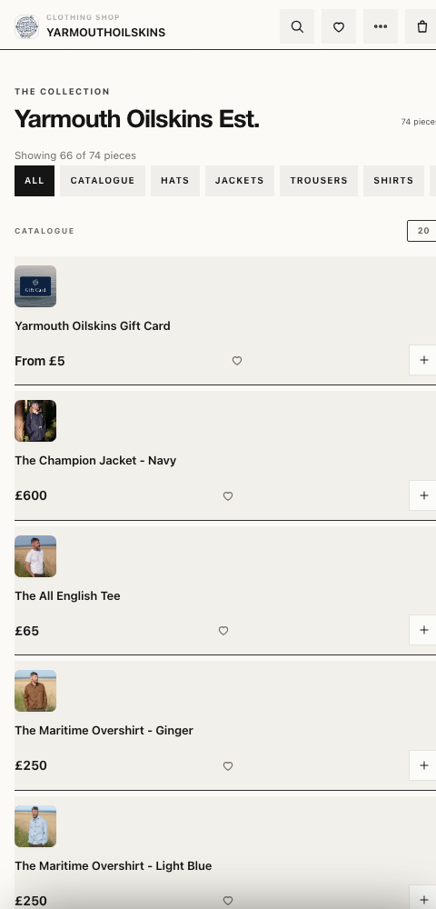
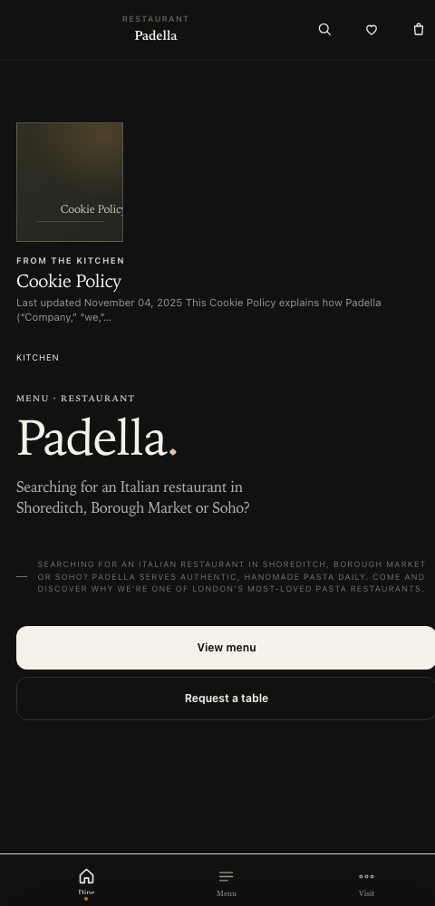
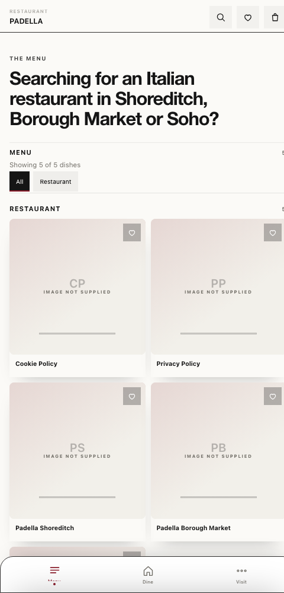
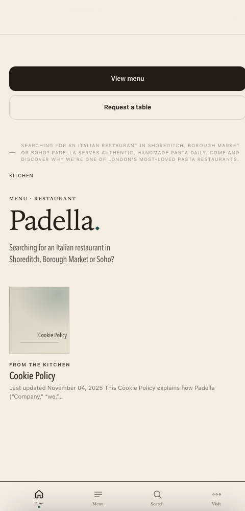
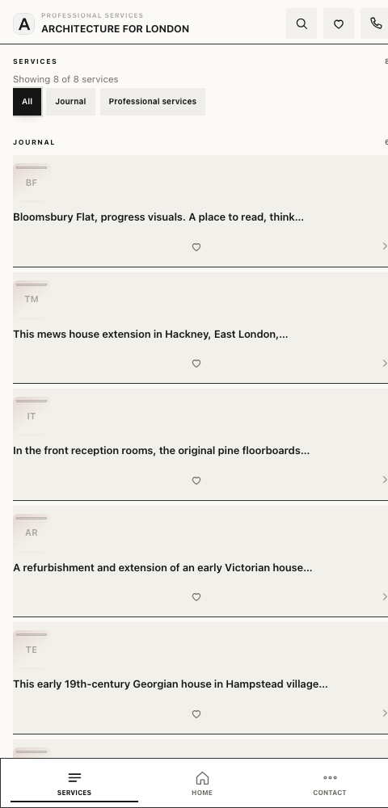
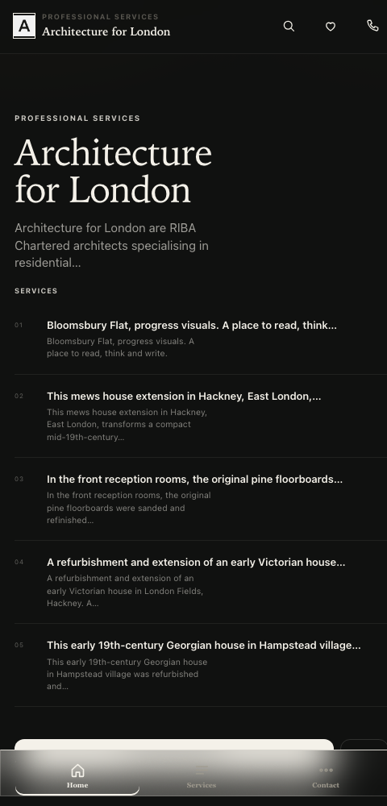
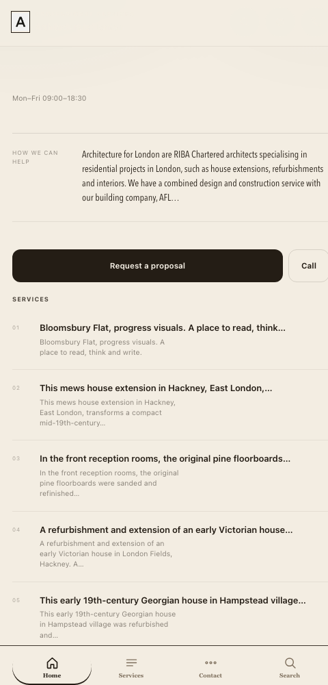

# Plattr AI trial: Groq vs OpenRouter

- Generated: 2026-11-23T17:05:59.806Z
- Mode: **mocked** — not comparable
- Gate: simulated (mocked mode)
- Same model on every arm: `openai/gpt-oss-120b`
- Comparison type: **provider-routing and gateway**, not gateway-only. The primary arms compare direct Groq with OpenRouter routing to the cheapest eligible endpoint; the controlled arm pins OpenRouter to its Groq endpoint with fallbacks disabled.
- The serving endpoint is recorded from each response; a pinned call served by anything else is refused, and an unpinned call that does not report its endpoint is not treated as a known vendor.
- Spend (simulated): $0.0128 of $30.00
- Limits: soft $0.18 / hard reservation $0.40 per generation, no top-up
- Scope: this is an initial nine-generation screening comparison (one sample per business and arm), not a winner determination. Mocked evidence is plumbing evidence, not model quality; live results are observations that may justify a larger run.

> Mocked deterministic stand-in answers. Neither provider was contacted, no money was spent, and the columns are not a quality comparison. The pinned control and the served-endpoint records are exercised with stand-in endpoint names. Set both keys and --approve-trial for the real run.

## Providers

| Arm | Gateway | Key | Model | Input /1M | Output /1M | Routing | Pricing note |
| --- | --- | --- | --- | --- | --- | --- | --- |
| primary | Groq · GroqCloud | `GROQ_API_KEY` | `openai/gpt-oss-120b` | $0.150 | $0.600 | direct to GroqCloud; no gateway in between | Groq production price, read 2026-11-23: $0.15 input / $0.075 cached input / $0.60 output per 1M tokens; 131,072 context; 65,536 max completion; strict json_schema supported. |
| primary | OpenRouter · cheapest eligible endpoint | `OPENROUTER_API_KEY` | `openai/gpt-oss-120b` | $0.030 | $0.150 | OpenRouter price-sorted routing over same-model endpoints with fallbacks allowed; the serving endpoint is unspecified until the response reports it | OpenRouter standard pay-as-you-go, read 2026-11-23: no inference markup; cheapest standard endpoints for this model $0.03 input / $0.15 output per 1M, dearest listed $0.35 / $0.95. Billed at the selected endpoint and settled from usage.cost. |
| controlled | OpenRouter · pinned to Groq | `OPENROUTER_API_KEY` | `openai/gpt-oss-120b` | $0.150 | $0.600 | OpenRouter pinned to its Groq endpoint (provider.only=["Groq"]) with fallbacks disabled; a response served by any other endpoint is refused | OpenRouter pinned to Groq with fallbacks off, read 2026-11-23: the endpoint is Groq's own $0.15 input / $0.075 cached input / $0.60 output per 1M. OpenRouter charges no inference markup for it; its 5.5% credit-purchase fee is paid at top-up, not per call, and is recorded separately. |

## Runs

| Business | Type | Arm | Status | Served by | Latency (ms) | Cost (USD) | Concepts | Diversity | Min axes | Nodes | Editable (missing/unknown) |
| --- | --- | --- | --- | --- | --- | --- | --- | --- | --- | --- | --- |
| Yarmouth Oilskins | Clothing retail | groq | ai | groq | 10 | 0.0019 | 3 | distinct | 7 | 12 | 0/0 |
| Yarmouth Oilskins | Clothing retail | openrouter | ai | MockedCheapestEndpoint | 1 | 0.0004 | 3 | distinct | 7 | 12 | 0/0 |
| Yarmouth Oilskins | Clothing retail | openrouter-groq (control) | ai | Groq | 1 | 0.0019 | 3 | distinct | 7 | 12 | 0/0 |
| Padella | Restaurant | groq | ai | groq | 2 | 0.0019 | 3 | distinct | 7 | 12 | 0/0 |
| Padella | Restaurant | openrouter | ai | MockedCheapestEndpoint | 2 | 0.0004 | 3 | distinct | 7 | 12 | 0/0 |
| Padella | Restaurant | openrouter-groq (control) | ai | Groq | 1 | 0.0019 | 3 | distinct | 7 | 12 | 0/0 |
| Architecture for London | Professional services | groq | ai | groq | 2 | 0.0019 | 3 | distinct | 7 | 18 | 3/0 |
| Architecture for London | Professional services | openrouter | ai | MockedCheapestEndpoint | 1 | 0.0004 | 3 | distinct | 7 | 18 | 3/0 |
| Architecture for London | Professional services | openrouter-groq (control) | ai | Groq | 1 | 0.0019 | 3 | distinct | 7 | 18 | 3/0 |

## Routing, charged cost and the cap

Every HTTP attempt is reserved before it is sent and settled with its charge, including an attempt that failed and was retried. `served` is what the gateway reported, not what the routing asked for. A timeout, dropped connection, 429/5xx, or an answer without usable billing information keeps its reservation as `retained` instead of refunding it.

| Business | Arm | Routing asked for | Endpoint(s) served | Attempts | Reserved (USD) | Charged (USD) | Retained (uncertain) | Accounted (USD) | Hard reservation (USD) | Within reservation | Charged ≤ reservation | Over reservation (USD) | Uncertain attempts | Retried |
| --- | --- | --- | --- | --- | --- | --- | --- | --- | --- | --- | --- | --- | --- |
| Yarmouth Oilskins | groq | direct to GroqCloud; no gateway in between | groq | 3 | 0.011201 | 0.001905 | 0.000000 | 0.001905 | 0.40 | yes | yes | 0.000000 | 0 | no |
| Yarmouth Oilskins | openrouter | OpenRouter price-sorted routing over same-model endpoints with fallbacks allowed; the serving endpoint is unspecified until the response reports it | MockedCheapestEndpoint | 3 | 0.018531 | 0.000447 | 0.000000 | 0.000447 | 0.40 | yes | yes | 0.000000 | 0 | no |
| Yarmouth Oilskins | openrouter-groq | OpenRouter pinned to its Groq endpoint (provider.only=["Groq"]) with fallbacks disabled; a response served by any other endpoint is refused; pinned to Groq | Groq | 3 | 0.011201 | 0.001905 | 0.000000 | 0.001905 | 0.40 | yes | yes | 0.000000 | 0 | no |
| Padella | groq | direct to GroqCloud; no gateway in between | groq | 3 | 0.011142 | 0.001905 | 0.000000 | 0.001905 | 0.40 | yes | yes | 0.000000 | 0 | no |
| Padella | openrouter | OpenRouter price-sorted routing over same-model endpoints with fallbacks allowed; the serving endpoint is unspecified until the response reports it | MockedCheapestEndpoint | 3 | 0.018392 | 0.000447 | 0.000000 | 0.000447 | 0.40 | yes | yes | 0.000000 | 0 | no |
| Padella | openrouter-groq | OpenRouter pinned to its Groq endpoint (provider.only=["Groq"]) with fallbacks disabled; a response served by any other endpoint is refused; pinned to Groq | Groq | 3 | 0.011142 | 0.001905 | 0.000000 | 0.001905 | 0.40 | yes | yes | 0.000000 | 0 | no |
| Architecture for London | groq | direct to GroqCloud; no gateway in between | groq | 3 | 0.011232 | 0.001905 | 0.000000 | 0.001905 | 0.40 | yes | yes | 0.000000 | 0 | no |
| Architecture for London | openrouter | OpenRouter price-sorted routing over same-model endpoints with fallbacks allowed; the serving endpoint is unspecified until the response reports it | MockedCheapestEndpoint | 3 | 0.018603 | 0.000447 | 0.000000 | 0.000447 | 0.40 | yes | yes | 0.000000 | 0 | no |
| Architecture for London | openrouter-groq | OpenRouter pinned to its Groq endpoint (provider.only=["Groq"]) with fallbacks disabled; a response served by any other endpoint is refused; pinned to Groq | Groq | 3 | 0.011232 | 0.001905 | 0.000000 | 0.001905 | 0.40 | yes | yes | 0.000000 | 0 | no |

The hard figure is a reservation/budget ceiling, not an absolute provider invoice cap. A reported charge above an attempt reservation is still booked; `Over reservation` and `Within reservation` expose any such overspend rather than clamping it.

## Screenshots

### Yarmouth Oilskins (Clothing retail)

- **groq / ledger** 
- **groq / index** 
- **groq / season** 
- **openrouter / ledger** 
- **openrouter / index** 
- **openrouter / season** 
- **openrouter-groq / ledger** 
- **openrouter-groq / index** 
- **openrouter-groq / season** 

### Padella (Restaurant)

- **groq / ledger** 
- **groq / index** 
- **groq / season** 
- **openrouter / ledger** 
- **openrouter / index** 
- **openrouter / season** 
- **openrouter-groq / ledger** 
- **openrouter-groq / index** 
- **openrouter-groq / season** 

### Architecture for London (Professional services)

- **groq / ledger** 
- **groq / index** 
- **groq / season** 
- **openrouter / ledger** 
- **openrouter / index** 
- **openrouter / season** 
- **openrouter-groq / ledger** 
- **openrouter-groq / index** 
- **openrouter-groq / season** 

The HTML beside each PNG is the same document the preview, editor and saved project read: `renderApp(spec, { doc })`.

## What each run measured

- **Factual grounding** — the brief is validated against the dossier before design; headings are checked for ungrounded or claim-bearing text; every issue code is listed per run.
- **Business relevance** — catalogue entries read, catalogue screens in the navigation, workflows the read established.
- **Concept diversity** — pairwise axes from the compiled documents; a palette-only triple is refused before this table is written.
- **Visual structure** — distinct palettes, type/hierarchy pairings and navigation models. Contrast is a validator rule; taste is not scored.
- **Completeness and editability** — concepts, screens, document nodes, components, and a coverage audit: every visible node must reach the rendered page under its own id, or it is not editable from the same document.
- **Latency** — wall clock for the whole generation and per stage. Mocked mode measures pipeline overhead only; the live run measures the gateways.
- **Cost and routing** — OpenRouter settles from its reported `usage.cost`; Groq is priced at its published rate from reported tokens. The endpoint that served each call is recorded, every attempt is reconciled against its reservation and the $0.40 cap, and a retried or failed attempt is counted rather than hidden. A charge that cannot be established (timeout, dropped connection, 429/5xx, no usage) is conservatively retained: it is never released as free and never disappears from the budget.

## Worst case per generation

| Gateway | Model | Reservation price in/out per 1M | Ceiling per generation |
| --- | --- | --- | --- |
| groq | `openai/gpt-oss-120b` | $0.15 / $0.60 | $0.0131 |
| openrouter | `openai/gpt-oss-120b` | $0.35 / $0.95 | $0.0231 |
| openrouter-groq | `openai/gpt-oss-120b` | $0.15 / $0.60 | $0.0131 |

## What still needs your keys

1. Put `GROQ_API_KEY` and `OPENROUTER_API_KEY` in `.dev.vars` (gitignored). They are not requested in chat and never logged.
2. Add `PLATTR_AI_TRIAL=approved` to `.dev.vars` for the duration of the trial.
3. Run `bun scripts/ai-trial.mjs --status` to confirm the gate, both keys and the pool without contacting a provider.
4. Run `bun scripts/ai-trial.mjs --live --approve-trial`. Nine generations (three businesses × three arms: Groq, OpenRouter cheapest, OpenRouter pinned to Groq) fit far inside the $30 pool; each is refused before its first call if it cannot reserve its $0.40 ceiling.
5. The live report is written to `docs/qa/ai-trial-2026-11-23/live/`. Nothing is deployed, published or written to production data.
